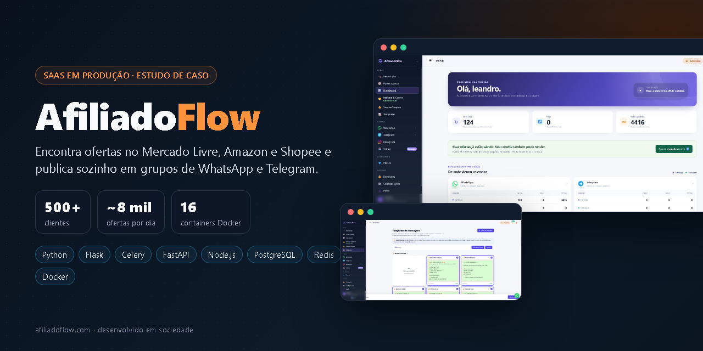
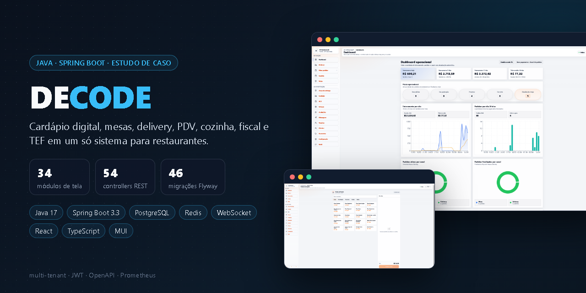
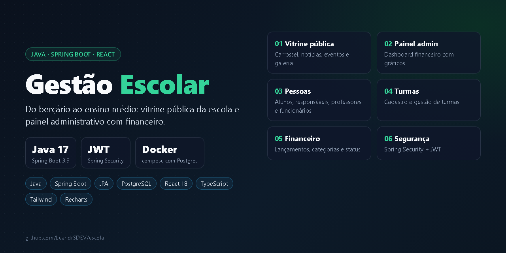
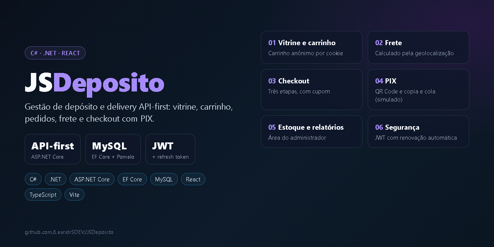

  
  
  

## Sobre mim

Construo backends que estão em produção e que pessoas usam todos os dias.

- 🏢 **Hoje:** desenvolvedor backend na **Portal Concursos**, em uma plataforma de preparação para concursos públicos com três serviços em **Java 25 + Spring Boot 4**, front em React e site em Astro.
- 🚀 **Em paralelo:** sócio e desenvolvedor do **[AfiliadoFlow](https://github.com/LeandrSDEV/afiliadoflow-saas)**, SaaS com **500+ clientes** que publica cerca de **8 mil ofertas por dia** no WhatsApp e no Telegram.
- 🧭 **Antes:** backend de sistemas de margem consignável (C#/.NET) na FASITEC, depois de quatro anos em crédito consignado — entendo a regra de negócio antes de escrever a primeira linha.
- 🎓 Análise e Desenvolvimento de Sistemas — Estácio (2027).

## Stack

<table>
  <tr>
    <td><b>Backend</b></td>
    <td></td>
  </tr>
  <tr>
    <td><b>Dados e infra</b></td>
    <td></td>
  </tr>
  <tr>
    <td><b>Front-end</b></td>
    <td></td>
  </tr>
</table>

Também no dia a dia: `Flyway` · `JWT / OAuth2` · `Keycloak` · `n8n` · `Webhooks` · `Celery` · `FastAPI` · `Playwright (E2E)` · `Zabbix` · `Swagger / OpenAPI`

## Projetos em destaque

<table>
  <tr>
    <td width="50%" valign="top">
      
      <b>AfiliadoFlow</b> — SaaS em produção com 500+ clientes. Coleta ofertas, gera o link de afiliado e publica sozinho no WhatsApp e no Telegram. 
      Python · Flask · Celery · FastAPI · Node.js · PostgreSQL · Redis · Docker 
      <a href="https://github.com/LeandrSDEV/afiliadoflow-saas">Estudo de caso</a> · <a href="https://www.afiliadoflow.com">Site</a>
    </td>
    <td width="50%" valign="top">
      
      <b>DECODE</b> — Sistema para lanchonetes e restaurantes: cardápio, mesas, delivery, PDV, cozinha, fiscal e TEF. Multi-tenant com schema por estabelecimento. 
      Java 17 · Spring Boot 3.3 · PostgreSQL · Flyway · Redis · WebSocket · React · TypeScript 
      <a href="https://github.com/LeandrSDEV/decode-restaurantes">Estudo de caso</a> · <a href="https://github.com/LeandrSDEV/admin_DecodeBack">API do painel admin</a>
    </td>
  </tr>
  <tr>
    <td width="50%" valign="top">
      
      <b>Gestão Escolar</b> — Vitrine pública da escola e painel administrativo com alunos, turmas e financeiro. 
      Java 17 · Spring Boot 3.3 · Spring Security · JWT · PostgreSQL · React · TypeScript · Tailwind 
      <a href="https://github.com/LeandrSDEV/escola">Repositório</a>
    </td>
    <td width="50%" valign="top">
      
      <b>JSDeposito</b> — Depósito e delivery API-first: vitrine, carrinho anônimo, frete por geolocalização e checkout com PIX. 
      C# · ASP.NET Core · EF Core · MySQL · JWT · React · TypeScript 
      <a href="https://github.com/LeandrSDEV/JSDeposito">API</a> · <a href="https://github.com/LeandrSDEV/JSDeposito_Front">Front-end</a>
    </td>
  </tr>
</table>

<b>Outros projetos</b>

 

| Projeto | O que é | Stack |
| --- | --- | --- |
| [admin_DecodeFront](https://github.com/LeandrSDEV/admin_DecodeFront) | Painel admin e portal do afiliado do DECODE | React 19 · TypeScript · Vite |
| [JS_Services](https://github.com/LeandrSDEV/JS_Services) | Automação de arquivos de servidores e beneficiários | .NET 8 · Clean Architecture · Blazor Server · SQL Server |
| [Projeto-Anime](https://github.com/LeandrSDEV/Projeto-Anime) | API de catálogo com filtros, testes e Docker | .NET · Clean Architecture · xUnit · Docker |
| [Formulario_Concurso](https://github.com/LeandrSDEV/Formulario_Concurso) | API de cadastro de aprovados com upload de imagem | Java 17 · Spring Boot · PostgreSQL |
| [First_API](https://github.com/LeandrSDEV/First_API) | API de consulta de CEP | ASP.NET Core · EF Core · SQL Server |
| [AGSWebsite](https://github.com/LeandrSDEV/AGSWebsite) | Site bilíngue para consultoria de geociências (EUA) | ASP.NET Core MVC |
| [portfolio-web](https://github.com/LeandrSDEV/portfolio-web) | Meu portfólio | React · TypeScript · Vite |

## Trajetória

| Período | Onde | O quê |
| --- | --- | --- |
| 2026 — hoje | Portal Concursos | Desenvolvedor Backend · Java 25, Spring Boot 4, React, Zabbix |
| 2026 — hoje | AfiliadoFlow | Sócio e Desenvolvedor · Python, Node.js, PostgreSQL, Redis |
| 2023 — 2025 | FASITEC | Desenvolvedor Backend · C#, ASP.NET MVC, SQL Server |
| 2019 — 2023 | Crédito consignado e atendimento bancário | Análise de crédito e cadastro — a base de negócio que uso no código |

## Atividade

<picture>
  <source media="(prefers-color-scheme: dark)" srcset="https://raw.githubusercontent.com/LeandrSDEV/LeandrSDEV/output/github-snake-dark.svg">
  
</picture>
